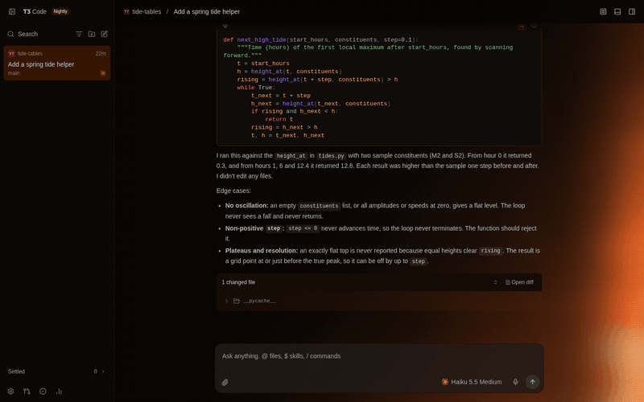
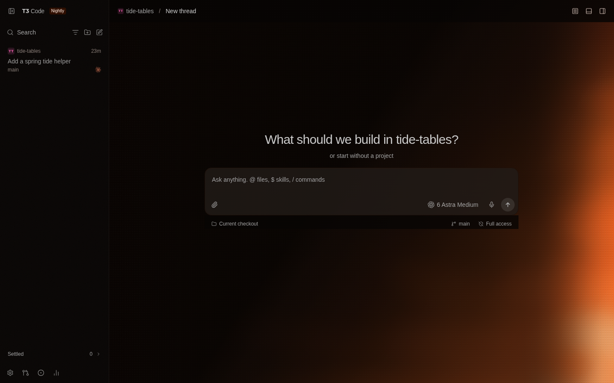
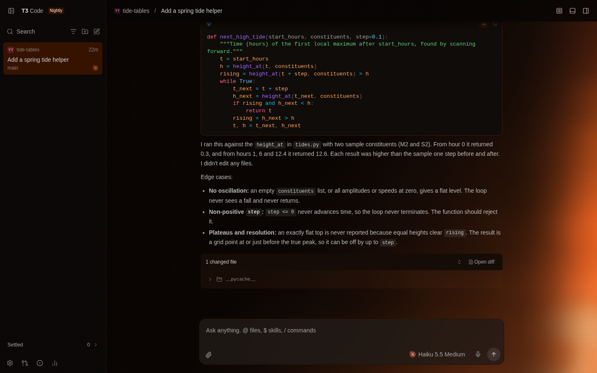

# Ember Backdrop

A dark theme for [T3 Code](https://t3.codes) that draws the Ember backdrop from
[neverblinks/backdrops](https://github.com/neverblinks/backdrops) behind the app: a dark, finely grained screen with a
warm orange glow in the bottom-right corner. Every 14 seconds the glow rises and fades once.



The picture is © 2026 neverblinks and is not free to redistribute. This repository is private.
Read [Credits and licence](#credits-and-licence) before you share it or make it public.

## Screenshots





The screenshots show T3 Code with an invented demo project.

## Install

1. Download [`theme.json`](theme.json).
2. In T3 Code, open **Settings**, then **Appearance**.
3. Under **Themes**, click **Add theme**.
4. Click **Choose files**, select `theme.json`, then click **Add theme**.

Or copy the file into T3 Code's theme folder as `ember-backdrop.json` and pick **Ember Backdrop** on the same page:

```sh
cp theme.json ~/.t3/userdata/themes/ember-backdrop.json
```

The theme is named Ember Backdrop because T3 Code has a built-in theme named Ember.

To go back, pick another theme on the same page.

Tested on T3 Code 0.1.11-nightly.20261118, in the web client in Chromium.

## What the theme changes

- **Backdrop.** Upstream's picture fills the window, behind the sidebar, the header and the chat.
- **Colours.** Upstream's Ember palette: warm near-black surfaces, grey text, an orange accent `#f07a32`.
- **Reading lane.** The picture is dimmed with `#0a0603` at 56 % behind the chat's text column, and clears over 13 rem
  on each side. Upstream uses 43 %. At 43 % the brightest pixel behind the text left body text at 5.6:1 and placeholder
  text at 3.6:1, so the lane is darker by 0.13. At 56 % `check.mjs` measures 7.1:1 and 4.5:1.
- **Sidebar and header.** Near-black (rgb 7 5 4) at 86 %, so the picture shows through faintly.

The chat's layout, message rows, composer and code blocks are T3 Code's own.

## What moves

One glow, every 14 seconds. Its opacity climbs from nothing to full over about 7 seconds in 0.25 second steps, holds
for a moment, and falls back the same way.

Nothing else moves. If your system asks for reduced motion, the glow stops.

## Change it

The theme is generated. Edit the constants at the top of `build.mjs`, then build again.

| Constant | What it does | Default |
|---|---|---|
| `LANE.opacity` | How dark the lane behind the chat text is | `0.56` |
| `LANE.tint` | The colour of the lane, as `r g b` | `10 6 3` |
| `LANE.pad` | How far the full dimming reaches past the text column on each side | `1rem` |
| `LANE.fade` | How far the lane takes to clear on each side | `13rem` |
| `PANEL.tint` | The colour behind the sidebar and the header | `7 5 4` |
| `PANEL.alpha` | Opacity of that colour | `0.86` |

## Build from source

You need Node.js. The build is tested with Node.js 26.

```sh
npm ci
node build.mjs
```

`build.mjs` reads upstream's scene from `vendor/backdrops/scene-ember.js` and writes `theme.json`. The scene is 20,494
characters and T3 Code holds 100,000 characters of theme CSS, so the scene goes in unchanged.

To check the result, run:

```sh
node check.mjs
```

`check.mjs` needs a Chromium binary. If yours is not at `/usr/bin/chromium`, set `CHROMIUM` to its path. It checks that:

- `theme.json` is what `build.mjs` produces and fits T3 Code's limits.
- The scene inside the CSS is upstream's scene, character for character, and still has its reduced-motion rule.
- Text keeps its contrast over the brightest pixel behind the chat, at 1512x949 and 2560x1440, in 12 moments of the
  loop: 7:1 for main text, 4.5:1 for muted and placeholder text.
- Drawn as a CSS background, the way T3 Code draws it, the glow moves, and it stands still in a Chromium started with
  `--force-prefers-reduced-motion`.
- T3 Code still has the parts of the app the theme hooks into. On Linux it finds a running T3 Code AppImage by itself.
  Otherwise set `T3_APP_ASAR` to the path of T3 Code's `app.asar`.

## Update from upstream

Copy the new `plugins/ember/hooks/scene-ember.js`, `LICENSE` and `ARTWORK.md` into `vendor/backdrops/`,
write the commit hash to `vendor/backdrops/COMMIT`, then run `node build.mjs` and `node check.mjs`.

## Limits

- **Size.** The theme uses 23,745 of T3 Code's 100,000 characters of CSS.
- **Internal names.** The reading lane follows the chat column through three CSS variables T3 Code sets, and the
  backdrop shows through boxes T3 Code's theme guide does not list as stable. A T3 Code update can rename one.
  The lane then centres on the chat area, or a box turns solid again. `node check.mjs` reports which names are missing.
- **Dark only.** The theme defines a dark appearance.
- **Mobile.** T3 Code's theme guide says its mobile apps do not use themes.

## Credits and licence

The picture and its glow come from [neverblinks/backdrops](https://github.com/neverblinks/backdrops), at the commit
in `vendor/backdrops/COMMIT`. Upstream's terms are in `vendor/backdrops/LICENSE` and `vendor/backdrops/ARTWORK.md`:

- The picture is © 2026 neverblinks, drawn in code.
- Anyone may use the theme for free, for any purpose. Nobody may redistribute the picture outside upstream's
  repository, sell it, or remove the credits, without permission.

`theme.json` contains the picture, so those terms cover it. Ask neverblinks before you make this repository public or
pass `theme.json` on.

`build.mjs` and `check.mjs` are under the [MIT License](LICENSE). [NOTICE.md](NOTICE.md) has the details.

This theme is not affiliated with T3 Code, neverblinks or Anthropic.
